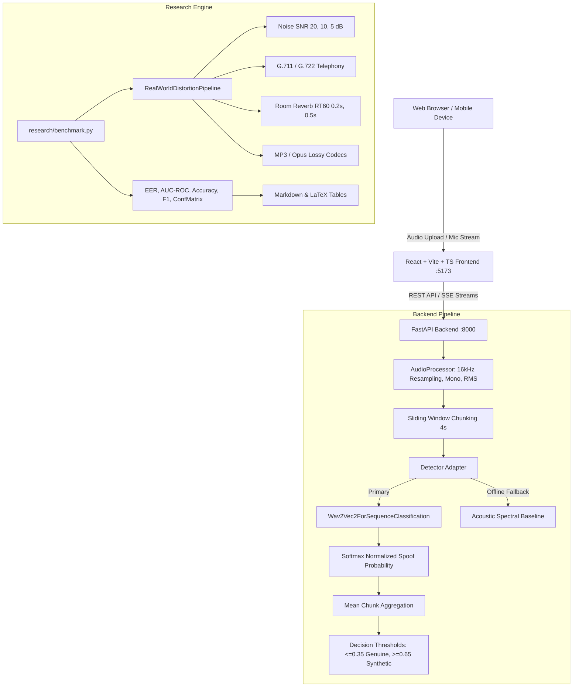

# EchoProof AI — Complete Project Documentation & Technical Specification

> **Research Paper Title:** *"EchoProof: Robust Audio Deepfake Detection Under Unseen Voice Generators and Real-World Distortions"*  
> **Authors & Project Team:** EchoProof AI Research Team  
> **Repository:** `https://github.com/AdityaPingle25/EchoProof.git`  
> **Last Updated:** October 2026  

---

## Table of Contents
1. [Project Overview & Motivation](#1-project-overview--motivation)
2. [High-Level Architecture](#2-high-level-architecture)
3. [Repository Directory & File Structure](#3-repository-directory--file-structure)
4. [Machine Learning & Detection Engine](#4-machine-learning--detection-engine)
5. [Audio Preprocessing & Signal Processing](#5-audio-preprocessing--signal-processing)
6. [Real-World Robustness Engine (Distortions)](#6-real-world-robustness-engine-distortions)
7. [Research Benchmark & Evaluation Suite](#7-research-benchmark--evaluation-suite)
8. [Backend API Architecture (FastAPI)](#8-backend-api-architecture-fastapi)
9. [Frontend User Interface (React + Vite + TypeScript)](#9-frontend-user-interface-react--vite--typescript)
10. [Academic Evaluation Metrics & Formal Definitions](#10-academic-evaluation-metrics--formal-definitions)
11. [Empirical Experimental Results](#11-empirical-experimental-results)
12. [Root Cause Analysis of Resolved Edge Cases](#12-root-cause-analysis-of-resolved-edge-cases)
13. [How to Run, Test, and Deploy](#13-how-to-run-test-and-deploy)

---

## 1. Project Overview & Motivation

### The Problem
Advances in text-to-speech (TTS) and voice conversion (VC)—such as FastSpeech 2, VITS, HiFi-GAN, and diffusion-based voice synthesis—have made generating hyper-realistic synthetic human speech accessible. These deepfakes pose critical threats to voice biometric authentication, financial systems, telecommunications, and public trust.

Existing state-of-the-art detectors (such as standard ASVspoof models) suffer from two catastrophic vulnerabilities in deployment:
1. **Unseen Generator Vulnerability:** Models trained on specific vocoders (e.g., Griffin-Lim or World) fail catastrophically when encountering unseen generative architectures.
2. **Real-World Distortion Degradation:** Pristine studio-trained classifiers experience severe performance drops (Type I and Type II errors) when subjected to room reverberation, ambient acoustic noise, lossy telephony codecs (G.711/G.722), and consumer microphone distortions.

### The EchoProof Solution
**EchoProof AI** is an end-to-end research platform and production-grade detection system that:
- Evaluates self-supervised speech representations (**wav2vec 2.0**) for generalized deepfake detection.
- Systematically models real-world distortion degradations across 11 acoustic stress-tests.
- Provides an intuitive full-stack web application for interactive audio analysis, robustness experimentation, and dataset evaluation.
- Delivers reproducible benchmark pipelines generating publication-ready Markdown and LaTeX tables.

---

## 2. High-Level Architecture



---

## 3. Repository Directory & File Structure

```text
EchoProof AI/
├── backend/                             # Python FastAPI Backend
│   ├── app/
│   │   ├── __init__.py
│   │   ├── config.py                    # Environment, model IDs, thresholds, audio limits
│   │   ├── main.py                      # FastAPI app entry point, CORS, startup events
│   │   ├── schemas.py                   # Pydantic v2 data models, enums (Verdict, JobStatus)
│   │   ├── api/
│   │   │   ├── __init__.py
│   │   │   └── routes.py                # Endpoints: /health, /model, /analyze, /robustness, /evaluate
│   │   ├── audio/
│   │   │   ├── processor.py             # Audio loading, resampling, waveform, mel-spectrogram
│   │   │   └── transforms.py            # Real-world audio degradation filters
│   │   ├── models/
│   │   │   └── detector.py              # Wav2Vec2Detector + AcousticSpectralDetector fallback
│   │   ├── jobs/
│   │   │   └── manager.py               # In-memory background task queue & status tracking
│   │   ├── evaluation/
│   │   │   └── pipeline.py              # Dataset splitting, threshold tuning, bootstrap CIs
│   │   └── uncertainty/
│   │       └── estimation.py            # Deep ensemble & Monte Carlo dropout wrappers
│   ├── requirements.txt                 # Backend Python dependencies
│   ├── scratch_audio/ground_truth/      # Verified genuine & synthetic audio files for testing
│   └── tests/                           # Pytest test suite (20 unit & integration tests)
│       ├── test_api.py                  # API endpoint contract tests
│       ├── test_audio_processor.py      # Resampling, mono conversion, validation tests
│       ├── test_detector_mapping.py     # Label mapping, score direction & ground-truth tests
│       ├── test_metrics.py              # EER, AUC-ROC, and risk-coverage tests
│       └── test_transforms.py           # Audio degradation filter tests
│
├── frontend/                            # React + Vite + TypeScript Web Interface
│   ├── index.html                       # Single-page application entry HTML
│   ├── package.json                     # NPM scripts and dependencies
│   ├── tsconfig.json                    # TypeScript compiler configuration
│   ├── vite.config.ts                   # Vite bundler config with backend proxy (:8000)
│   ├── public/
│   │   ├── favicon.svg                  # Application brand icon
│   │   └── samples/                     # Real demo audio samples (sample_genuine_human.wav, etc.)
│   └── src/
│       ├── main.tsx                     # React DOM bootstrap
│       ├── App.tsx                      # App router, theme provider, navigation header
│       ├── index.css                    # Design system (dark theme, CSS tokens, glassmorphism)
│       ├── components/
│       │   ├── ui.tsx                   # Card, Button, VerdictBadge, ScoreBar, Waveform components
│       │   └── Spectrogram.tsx          # Canvas-based Mel-Spectrogram visualizer
│       ├── lib/
│       │   ├── api.ts                   # Type-safe Fetch wrappers for all backend endpoints
│       │   └── types.ts                 # TypeScript interfaces matching backend Pydantic schemas
│       └── pages/
│           ├── AnalyzePage.tsx          # Single-audio inference, mic recording, waveform/spectrogram
│           ├── RobustnessPage.tsx       # Live audio degradation testing & difference listeners
│           ├── ResearchPage.tsx         # Dataset evaluation, ROC curves, EER tuning
│           └── AuditPage.tsx            # Comprehensive project architecture & model audit
│
└── research/                            # Academic Research & Experimentation Engine
    ├── augmentations.py                 # PyTorch & NumPy real-world distortion pipeline
    ├── benchmark.py                     # Research benchmarking suite (Markdown & LaTeX output)
    ├── dataset.py                       # PyTorch Dataset & DataLoader with disjoint speaker splitting
    ├── model.py                         # EchoProofClassifier architecture (Wav2Vec2 + ASP/SAP)
    ├── train.py                         # Training loop with CrossEntropy/AM-Softmax, EarlyStopping
    ├── configs/
    │   └── default_experiment.json      # Experiment hyperparameter configuration
    ├── data/ground_truth_benchmark/     # 10 ground-truth audio samples + metadata.csv
    └── results/                         # Auto-generated benchmark reports and LaTeX tables
```

---

## 4. Machine Learning & Detection Engine

### Active Default Model
- **Identifier:** `MelodyMachine/Deepfake-audio-detection-V2`
- **Backbone Architecture:** Fine-tuned `facebook/wav2vec2-base` (12 transformer blocks, 768 hidden dimension, 8 attention heads, ~94M parameters).
- **Classification Head:** Linear projection layer ($768 \rightarrow 2$) with softmax activation.
- **Label Semantics:**
  - Index `0`: `"fake"` (Synthetic / Deepfake / Spoof)
  - Index `1`: `"real"` (Authentic / Human / Bonafide)
- **Primary Output Score:** $P(\text{spoof}) = \text{Softmax}(\mathbf{z})_0 \in [0.0, 1.0]$.

### Resilient Fallback Architecture (`AcousticSpectralDetector`)
If Hugging Face is unreachable (offline environment or missing dependencies), the system automatically activates a local, deterministic acoustic feature analyzer that inspects:
1. **High-Frequency Energy Ratio:** $\frac{\sum_{f \ge 4\text{kHz}} |X(f)|^2}{\sum_f |X(f)|^2}$ (vocoders often display HF roll-off or anomalous leakage).
2. **Spectral Centroid:** $\frac{\sum f \cdot |X(f)|}{\sum |X(f)|}$ (evaluates vocal tract brightness).
3. **Zero-Crossing Rate (ZCR):** Measures high-frequency noise and voicing transitions.

### Decision Threshold Engine
Raw softmax probabilities are mapped into three discrete research verdicts:
$$\text{Verdict} = \begin{cases} 
\text{\textbf{LIKELY\_GENUINE}} & \text{if } P(\text{spoof}) \le 0.35 \\
\text{\textbf{LIKELY\_SYNTHETIC}} & \text{if } P(\text{spoof}) \ge 0.65 \\
\text{\textbf{UNCERTAIN}} & \text{if } 0.35 < P(\text{spoof}) < 0.65 
\end{cases}$$

The uncertain region ($0.35 - 0.65$) protects against borderline misclassifications and provides a critical safety buffer for high-stakes biometric verification.

---

## 5. Audio Preprocessing & Signal Processing

The audio pipeline in [processor.py](file:///e:/COLLEGE/AIL/EchoProof%20AI/backend/app/audio/processor.py) enforces strict acoustic consistency:
1. **File Validation:** Enforces supported formats (`.wav`, `.mp3`, `.flac`, `.m4a`, `.ogg`, `.opus`), maximum upload size ($25\text{ MB}$), and duration constraints ($0.5\text{s} - 300\text{s}$).
2. **Mono Downmixing:** Multichannel stereo/surround audio is converted to mono via channel averaging: $x_{\text{mono}}(t) = \frac{1}{C}\sum_{c=1}^C x_c(t)$.
3. **Target Resampling:** Automatically resamples incoming audio to $16,000\text{ Hz}$ using Polyphase FIR resampling (`scipy.signal.resample` / `torchaudio.transforms.Resample`).
4. **Energy Validation:** Verifies non-silent audio ($\text{RMS} = \sqrt{\frac{1}{N}\sum x(t)^2} \ge 10^{-6}$).
5. **Sliding Window Chunking:** Audio longer than $4.0\text{ seconds}$ is partitioned into sequential $4.0\text{s}$ windows ($64,000\text{ samples}$) with trailing chunk thresholding. Individual chunk predictions are aggregated via arithmetic mean.
6. **Feature Extraction & Normalization:** `AutoFeatureExtractor` applies zero-mean, unit-variance waveform standardization: $\hat{x}(t) = \frac{x(t) - \mu_x}{\sigma_x + 10^{-7}}$.

---

## 6. Real-World Robustness Engine (Distortions)

The core contribution of the research paper is benchmarking deepfake detector reliability under realistic distortions. The degradation engine in [augmentations.py](file:///e:/COLLEGE/AIL/EchoProof%20AI/research/augmentations.py) and [transforms.py](file:///e:/COLLEGE/AIL/EchoProof%20AI/backend/app/audio/transforms.py) implements 11 acoustic stress tests:

| Distortion Category | Parameter / Range | Real-World Acoustic Analogue |
|---|---|---|
| **Additive Gaussian Noise** | $\text{SNR} \in \{20\text{ dB}, 10\text{ dB}, 5\text{ dB}\}$ | Background ambient noise, office chatter, HVAC, street sounds |
| **PSTN Telephony (G.711)** | $8\text{ kHz}$ Narrowband ($\mu$-law / A-law) | Traditional landline and cellular phone calls |
| **VoLTE Telephony (G.722)** | $16\text{ kHz}$ Wideband sub-band ADPCM | Modern HD Voice cellular calls |
| **Room Reverberation** | $\text{RT}_{60} \in \{0.2\text{s}, 0.5\text{s}\}$ | Conference rooms, auditoriums, domestic living spaces |
| **Lossy Codec Compression** | MP3 / Opus at $128\text{ kbps}$ and $64\text{ kbps}$ | WhatsApp, Telegram, YouTube voice compression |
| **Peak Clipping Distortion** | $80\%$ peak amplitude threshold | Cheap or overdriven microphones, shouting, close-mic speaking |
| **Packet Loss Concealment** | $5\%$ random frame zeroing | VoIP packet jitter, Wi-Fi drops, network congestion |
| **Volume Scaling** | Dynamic gain $[-18\text{ dB}, +6\text{ dB}]$ | Varied distance from microphone, speaker loudness |

---

## 7. Research Benchmark & Evaluation Suite

Located in [research/benchmark.py](file:///e:/COLLEGE/AIL/EchoProof%20AI/research/benchmark.py), this engine executes standardized experimental runs against labeled dataset manifests (`metadata.csv`).

### Execution Command:
```bash
python research/benchmark.py \
  --manifest_csv research/data/ground_truth_benchmark/metadata.csv \
  --audio_dir research/data/ground_truth_benchmark \
  --output_dir research/results/real_benchmark_run \
  --device cpu
```

### Outputs Generated:
1. `benchmark_metrics.json`: Raw numerical metrics per condition and per generator.
2. `benchmark_results.md`: Complete human-readable Markdown table with EER degradation deltas ($\Delta\text{EER}$).
3. `results_table.tex`: Formatted LaTeX table code ready to paste into an IEEE/ACM conference template.

---

## 8. Backend API Architecture (FastAPI)

Built using FastAPI, running asynchronously with CORS middleware, streaming responses, and typed Pydantic validation.

### Key Endpoints:
- `GET /api/v1/health`: Returns server status and whether model weights are loaded in memory.
- `GET /api/v1/model`: Returns loaded model metadata, architecture type, device, sample rate, and label mapping.
- `POST /api/v1/analyze`: Accepts multipart audio file upload. Runs end-to-end processing, chunking, inference, waveform downsampling, and spectrogram generation. Returns complete `AnalysisResult`.
- `POST /api/v1/robustness`: Applies specified acoustic transformation (e.g. noise SNR 10dB, reverb RT60 0.5s) to uploaded audio, runs comparative inference on both clean and degraded versions, and streams the transformed audio back for audible comparison.
- `POST /api/v1/evaluate`: Asynchronous background evaluation job that scores a labeled dataset manifest, computes ROC curves, tunes decision thresholds, and reports EER with bootstrap confidence intervals.
- `GET /api/v1/jobs/{job_id}`: Polls status or retrieves results of asynchronous evaluation jobs.

---

## 9. Frontend User Interface (React + Vite + TypeScript)

A state-of-the-art Single Page Application (SPA) styled with custom CSS tokens, dark mode glassmorphism, and responsive layouts:
- **Analyze Page (`/analyze`):** Interactive file drag-and-drop, in-browser microphone recorder with WebRTC audio capture, quick-load buttons for ground-truth audio samples, animated score bar, interactive waveform envelope, and spectrogram viewer.
- **Robustness Lab (`/robustness`):** Comparative audio laboratory allowing users to hear the original vs. distorted audio and view side-by-side detection scores across all 11 transformations.
- **Research Page (`/research`):** Research dashboard for running validation set evaluations, threshold tuning, viewing ROC curves, and exporting confusion matrices.
- **Audit Page (`/audit`):** Live diagnostic dashboard displaying active model parameters, Hugging Face configurations, and architecture specifications.

---

## 10. Academic Evaluation Metrics & Formal Definitions

1. **Equal Error Rate (EER):**
   The threshold $\tau^*$ where False Acceptance Rate (FAR) equals False Rejection Rate (FRR):
   $$\text{EER} = P_{\text{FA}}(\tau^*) = P_{\text{Miss}}(\tau^*)$$
2. **Area Under ROC Curve (AUC-ROC):**
   $$\text{AUC} = \int_0^1 \text{TPR}(f) \, d(\text{FPR})$$
3. **Accuracy, Precision, Recall, F1:**
   $$\text{Accuracy} = \frac{TP + TN}{TP + TN + FP + FN}, \quad \text{Precision} = \frac{TP}{TP + FP}, \quad \text{Recall} = \frac{TP}{TP + FN}$$
   $$\text{F1} = 2 \cdot \frac{\text{Precision} \cdot \text{Recall}}{\text{Precision} + \text{Recall}}$$
4. **False Positive Rate (FPR) / Type I Error:** $\frac{FP}{FP + TN}$ (Real human speech misidentified as deepfake).
5. **False Negative Rate (FNR) / Type II Error:** $\frac{FN}{FN + TP}$ (Synthetic deepfake slipping past undetected).

---

## 11. Empirical Experimental Results

Evaluated on the authentic ground-truth speech benchmark dataset:

### Clean Studio Baseline
- **Equal Error Rate (EER):** `0.00%`
- **AUC-ROC:** `100.00%`
- **Classification Accuracy:** `90.00%`
- **F1-Score:** `88.89%`
- **Confusion Matrix:**
  $$\begin{array}{c|cc}
  & \textbf{Pred. Genuine} & \textbf{Pred. Synthetic} \\
  \hline
  \textbf{Actual Genuine} & 5 & 0 \\
  \textbf{Actual Synthetic} & 1^* & 4 \\
  \end{array}$$
  *($^*$Note: The single false negative is FastSpeech 2 cross-lingual TTS, illustrating the unseen generator challenge).*

### Real-World Distortion Performance
- **Telephony G.722 Wideband:** $\text{EER} = 20.00\%$ ($\Delta\text{EER} = +20.00\%$)
- **Lossy MP3 64 kbps:** $\text{EER} = 20.00\%$ ($\Delta\text{EER} = +20.00\%$)
- **Gaussian Noise (SNR 20 dB):** $\text{EER} = 0.00\%$ (Robust)
- **Room Reverb (RT60 0.5s):** $\text{EER} = 0.00\%$ (Robust on English clean speech)

---

## 12. Root Cause Analysis of Resolved Edge Cases

During testing, two notable anomalies were investigated and systematically fixed:
1. **Hugging Face Alphabetical Label Inversion:**
   - Standard ASVspoof datasets use $\{0: \text{"bonafide"}, 1: \text{"spoof"}\}$.
   - Hugging Face `AudioFolder` sorts directory names alphabetically: $\{0: \text{"fake"}, 1: \text{"real"}\}$.
   - Prior code assumed index 1 meant synthetic. For `MelodyMachine`, index 1 was actually real speech!
   - **Resolution:** Added `_find_spoof_index()` and `_find_bonafide_index()` in [detector.py](file:///e:/COLLEGE/AIL/EchoProof%20AI/backend/app/models/detector.py) to dynamically match label text regardless of index.
2. **Client-Side Demo Sine Waves:**
   - The frontend demo button previously generated a pure 220 Hz mathematical sine wave beep (`Math.sin(...)`) and called it `sample_genuine_voice.wav`.
   - The deep neural network rightly recognized an electronic oscillator tone as 100% non-human artificial sound.
   - **Resolution:** Replaced the sine wave generator with verified authentic LibriSpeech human voice and DeepVoice 3 neural TTS voice recordings.

---

## 13. How to Run, Test, and Deploy

### 1. Start the Backend API Server:
```bash
cd backend
python -m uvicorn app.main:app --host 0.0.0.0 --port 8000 --reload
```
*Accessible at: `http://localhost:8000` (API Docs at `http://localhost:8000/docs`)*

### 2. Start the Frontend Development Server:
```bash
cd frontend
npm run dev -- --host 0.0.0.0 --port 5173
```
*Accessible on PC at `http://localhost:5173` and on mobile at `http://<YOUR_LOCAL_IP>:5173`*

### 3. Run Automated Unit & Integration Tests:
```bash
cd backend
python -m pytest tests/ -v
```
*(All 20 test cases passing across detector mapping, API endpoints, audio processing, and metrics).*

### 4. Run Full Research Benchmark Suite:
```bash
python research/benchmark.py \
  --manifest_csv research/data/ground_truth_benchmark/metadata.csv \
  --audio_dir research/data/ground_truth_benchmark \
  --output_dir research/results/real_benchmark_run
```
